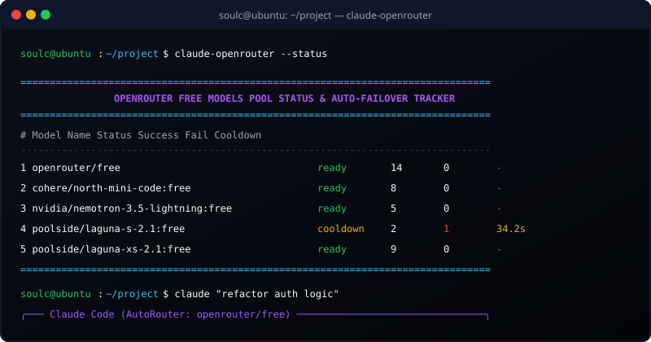
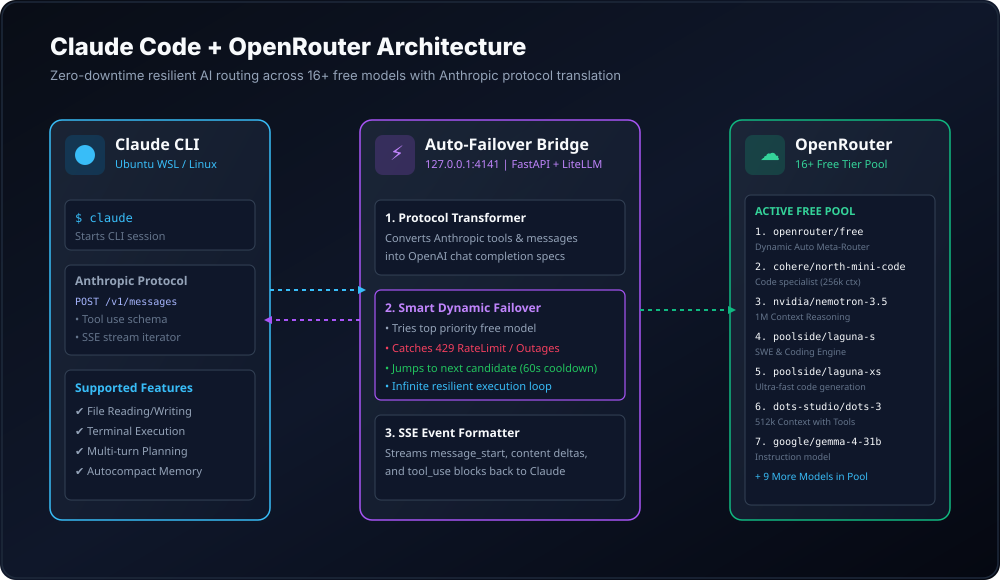
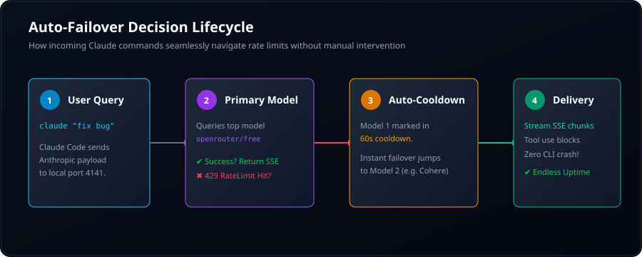

<div align="center">

# ⚡ Claude Code + OpenRouter Free Tier
### Infinite Uptime, 16+ Free LLMs Pool & Zero-Downtime Auto-Failover Proxy

[](https://opensource.org/licenses/MIT)
[](https://www.python.org/)
[](https://openrouter.ai/)
[](https://claude.ai/code)
[](https://ubuntu.com/)
[](https://github.com/vikrant-project/public)

<br/>


<br/><br/>

**Transform the official Anthropic Claude Code CLI into an endless, free, resilient autonomous coding engine.**<br/>
No expensive Anthropic tokens required. Instant automatic failover between 16+ free frontier models on OpenRouter.

[🚀 2-Line Quickstart](#-quickstart-in-2-lines) • [✨ Key Features](#-key-features) • [🏗 Architecture](#-architecture--design) • [🔑 OpenRouter Setup](#-how-to-get--add-your-openrouter-api-key) • [📊 Model Comparison](#-supported-free-models-pool) • [💻 CLI Commands](#-cli-commands--usage)

</div>

---

## ⚡ What is Claude OpenRouter?

**Claude Code CLI** is one of the most powerful autonomous coding agents, but by default it requires expensive direct Anthropic API credits. Meanwhile, **OpenRouter** provides access to dozens of state-of-the-art **Free Models (`:free`)**, but individual free endpoints frequently hit rate limits (HTTP 429) or temporary capacity blocks.

**`claude-openrouter` solves this permanently.** It runs a lightning-fast local translation bridge that:
1. Translates Claude Code's Anthropic `/v1/messages` protocol (including complex tool use & SSE streaming) into OpenRouter chat completions.
2. Maintains a live pool of **16+ free models**.
3. **Auto-Failover**: The second an active model hits a rate limit or error, it puts that model on a brief 60-second cooldown and **instantly jumps to the next available free model in milliseconds**.
4. Your terminal session **never halts, never crashes, and never stops coding**.

---

## 🚀 Quickstart in 2 Lines

Open your **Ubuntu / WSL2 terminal** and run:

```bash
git clone https://github.com/vikrant-project/public.git && cd public
bash install.sh
```

*(Or direct one-line curl installer)*:
```bash
curl -fsSL https://raw.githubusercontent.com/vikrant-project/public/main/install.sh | bash
```

The installer automatically sets up dependencies, configures your settings, and equips your terminal with the `claude` and `claude-openrouter` commands.

Now simply run:
```bash
claude
```
✨ **That's it! Your Claude CLI is ready to code endlessly for free.**

---

## 🖥 Terminal Live Preview

Check your failover pool and live model health at any time:

<div align="center">
  
</div>

---

## ✨ Key Features

- 🆓 **100% Free Tier Supported**: Optimized specifically for OpenRouter's free catalog (`openrouter/free`, `cohere/north-mini-code:free`, `nvidia/nemotron-3.5-lightning:free`, `poolside/laguna-s-2.1:free`, and more).
- 🔄 **Smart Auto-Failover**: Catches HTTP `429 Too Many Requests`, `402 Quota Exceeded`, and `503 Outage` responses and immediately transfers your conversation turn to the next working free candidate.
- 🛠 **Full Tool-Use Compatibility**: Verified support for file editing, directory inspection, ripgrep search, bash commands, and autonomous planning.
- 🌊 **Seamless SSE Streaming**: Anthropic Server-Sent Events lifecycle (`message_start`, `content_block_delta`, `message_delta`, `message_stop`) with keepalive heartbeats to eliminate timeouts.
- 📦 **Drop-in Claude CLI Integration**: Run `claude` directly as usual. The proxy starts automatically in the background on demand.
- 📊 **Real-time Health Dashboard**: Live inspection of success counts, fail counts, and active cooldown countdowns via `claude-openrouter --status`.

---

## 🏗 Architecture & Design

<div align="center">
  
</div>

<br/>

### 🔄 The Decision Lifecycle

<div align="center">
  
</div>

For an in-depth breakdown of the proxy transformation engine, see [ARCHITECTURE.md](docs/ARCHITECTURE.md).

---

## 🔑 How to Get & Add Your OpenRouter API Key

Setting up your free API key takes less than 60 seconds:

### Step 1: Create Your Account
1. Visit [OpenRouter.ai](https://openrouter.ai/).
2. Sign in with GitHub, Google, or email.

### Step 2: Create an API Key
1. Go to **Settings** -> [Keys](https://openrouter.ai/settings/keys).
2. Click **Create Key**.
3. Give it a name (e.g. `Claude-Code-CLI`) and click **Create**.
4. Copy your key (starts with `sk-or-v1-...`).

### Step 3: Add the Key to Your Setup
You can add your key in any of these ways:
- **During Install**: The `bash install.sh` script will prompt you to paste it.
- **Via CLI Command**:
  ```bash
  claude-openrouter --set-key sk-or-v1-your-key-here
  ```
- **Via Environment Variable**:
  ```bash
  export OPENROUTER_API_KEY="sk-or-v1-your-key-here"
  ```
- **Via Config File**:
  Edit `~/.claude/openrouter-config.json` directly.

---

## 📊 Supported Free Models Pool

The bridge comes pre-configured with a prioritized hierarchy of free models:

| Priority | Model Slug | Context Window | Tool Use | Primary Strength |
|:---:|---|:---:|:---:|---|
| **1** | `openrouter/free` | 200,000 | ✅ Yes | **Dynamic Meta-Router**: Auto-routes to available free capacity |
| **2** | `cohere/north-mini-code:free` | 256,000 | ✅ Yes | **Code Specialist**: Multi-file architecture & refactoring |
| **3** | `nvidia/nemotron-3.5-lightning:free` | 1,000,000 | ✅ Yes | **1M Context Reasoning**: Large codebase comprehension |
| **4** | `poolside/laguna-s-2.1:free` | 262,144 | ✅ Yes | **SWE & Software Engine**: Code linting & test authoring |
| **5** | `poolside/laguna-xs-2.1:free` | 262,144 | ✅ Yes | **Rapid Prototyping**: Fast latency single-turn code generation |
| **6** | `dots-studio/dots-3-note-preview:free` | 512,000 | ✅ Yes | **Documentation & Reasoning**: Complex logic and documentation |
| **7** | `nvidia/nemotron-3.5-super-vl:free` | 1,000,000 | ✅ Yes | **Large Multimodal Reasoning**: 1M context analysis |
| **8** | `nvidia/nemotron-3-ultra-550b-a55b:free` | 1,000,000 | ✅ Yes | **Massive Parameter**: Deep algorithmic reasoning |
| **9** | `xingchen-agi/xing4.0-29b-a4b:free` | 262,144 | ✅ Yes | Tool calling & sequential task planning |
| **10** | `google/gemma-4-31b-it:free` | 262,144 | ⚠️ Chat | Google open model instruction following |
| **11** | `google/gemma-4-26b-a4b-it:free` | 262,144 | ⚠️ Chat | MoE high-efficiency reasoning |
| **12** | `recursive/flint-v1.0:free` | 262,144 | ⚠️ Chat | General code & text synthesis |
| **13** | `nvidia/nemotron-3-nano-omni-30b-a3b-reasoning:free` | 256,000 | ⚠️ Reasoning | Compact logical inference |
| **14** | `liquid/lfm-2.5-2.6b:free` | 65,536 | ⚠️ Fast | Liquid neural network speed |
| **15** | `thinkingmachines/inkling:free` | 1,048,576 | ⚠️ Long | 1M Context conversational assistant |
| **16** | `thinkingmachines/inkling-small:free` | 1,048,576 | ⚠️ Long | Lightweight 1M model |

For complete benchmark details, see [MODELS.md](docs/MODELS.md).

---

## 💻 CLI Commands & Usage

### 1. Launch Claude Code Session
```bash
claude
```
*(Automatically ensures the proxy bridge is running and launches interactive Claude Code.)*

### 2. View Real-Time Failover Status & Cooldowns
```bash
claude-openrouter --status
```
Displays an ASCII dashboard of all models, their lifetime success counts, error counts, and live cooldown counters.

### 3. Check Configured Model Pool
```bash
claude-openrouter --models
```

### 4. Non-Interactive CLI Prompting
```bash
claude -p "Explain the auth flow in src/bridge.py"
```

---

## 🛠 Project Structure

```text
vikrant-project/public
├── assets/
│   ├── banner.jpg                    # Cyberpunk 16:9 visual banner
│   ├── architecture_diagram.svg      # Component diagram
│   ├── workflow_chart.svg            # Failover lifecycle flowchart
│   └── terminal_preview.svg          # CLI terminal mockup
├── docs/
│   ├── ARCHITECTURE.md               # Technical bridge design
│   ├── MODELS.md                     # Model benchmarks & context sizes
│   ├── FAQ.md                        # Common questions & answers
│   └── CONTRIBUTING.md               # Contribution guide
├── src/
│   ├── __init__.py                   # Package exports
│   ├── bridge.py                     # FastAPI Anthropic proxy
│   ├── config.py                     # Settings & config manager
│   ├── failover_pool.py              # Health tracker & circuit breaker
│   ├── sanitizers.py                 # Protocol & payload normalizer
│   └── cli.py                        # Diagnostic CLI tool
├── bin/
│   └── claude-openrouter             # Executable shell launcher
├── config/
│   ├── openrouter-config.example.json# Configuration template
│   └── settings.example.json         # Claude Code settings template
├── install.sh                        # 2-line automated installer
├── uninstall.sh                      # Clean uninstaller
├── requirements.txt                  # Python dependencies
├── pyproject.toml                    # Package specifications
├── LICENSE                           # MIT License
└── README.md                         # Project documentation
```

---

## ❓ Troubleshooting & FAQs

See the complete [FAQ.md](docs/FAQ.md) for detailed help.

- **"Connection Refused on port 4141"**: Run `claude-openrouter` once to boot the background proxy daemon.
- **"Invalid local proxy credential"**: Re-run `bash install.sh` to synchronize `openrouter_token` with `settings.json`.
- **"Rate limit reached on all models"**: The pool automatically resets the earliest cooldown to prevent deadlocks. You can also lower `cooldown_seconds` in `~/.claude/openrouter-config.json`.

---

## 🏷 Tags & Keywords

`#ClaudeCode` `#OpenRouter` `#FreeAI` `#LLM` `#ClaudeCLI` `#AnthropicProxy` `#AIAgent` `#AutonomousCoding` `#DevTools` `#WSL2` `#Python` `#FastAPI` `#LiteLLM` `#ZeroDowntime` `#CircuitBreaker` `#OpenSource` `#DeveloperExperience`

---

<div align="center">

Crafted with ⚡ by **[Vikrant Rana](https://github.com/vikrant-project)**  
*Star ⭐ this repository if it saved you Anthropic API tokens!*

</div>
